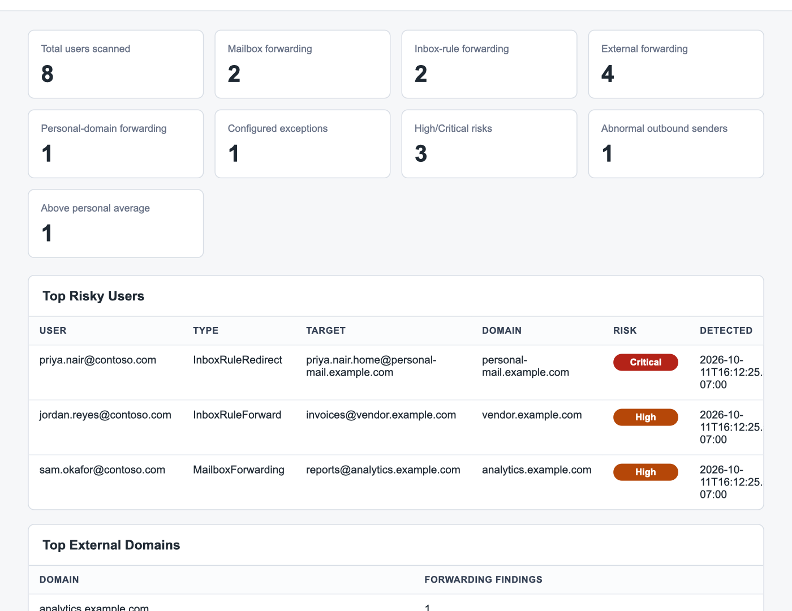

# Microsoft 365 Forwarding Monitor

[](https://github.com/nlj3/m365-forwarding-monitor/actions/workflows/ci.yml)
[](LICENSE)

Metadata-only Microsoft 365 forwarding monitoring for internal IT and security visibility.

This tool detects mailbox forwarding, inbox rules that forward or redirect, external and personal forwarding targets, and abnormal outbound email volume using metadata only. It generates local JSON/CSV output and a static HTML dashboard.

I wrote it because mail forwarding to an outside address is the quietest way data leaves a small company, and the admin center gives you no single place to see it. It runs on a schedule and leaves one page to read.

## Privacy First

This repo is intentionally metadata-only.

It does not request `Mail.Read` or `Mail.ReadWrite`. It does not read or store email bodies, message content, subjects, message previews, attachment contents, or individual message content.

## What It Does

- Lists enabled internal users with Microsoft Graph.
- Checks Exchange Online mailbox forwarding settings.
- Checks Graph inbox message rule forwarding actions:
  - `actions.forwardTo`
  - `actions.redirectTo`
  - `actions.forwardAsAttachmentTo`
- Counts outbound external message trace metadata with `Get-MessageTraceV2`.
- Builds a local metadata-only baseline of each sender's external outbound count over time.
- Flags attention events when a sender is over the configured count threshold, above their personal average, or sending unusual after-hours volume.
- Flags external forwarding, personal-domain forwarding, approved exceptions, and outbound volume anomalies.
- Writes local JSON/CSV metadata and a static dashboard.

## What The Dashboard Looks Like



This image comes from `samples/dashboard.html`, which is built from made-up contoso.com users by `samples/New-SampleDashboard.ps1`. No tenant is needed to regenerate it:

```powershell
pwsh -NoProfile -File ./samples/New-SampleDashboard.ps1
```

## What It Intentionally Does Not Do

- Does not read email body text.
- Does not read or store subjects.
- Does not read attachment contents.
- Does not store message previews.
- Does not delete inbox rules.
- Does not disable forwarding.
- Does not modify tenant settings.
- Does not prove which individual messages were forwarded.
- Does not approve, deny, block, or enforce anything. Labels are for review only.

## Required PowerShell Modules

Run in PowerShell 7:

```powershell
Install-Module Microsoft.Graph.Authentication -Scope CurrentUser
Install-Module ExchangeOnlineManagement -Scope CurrentUser
```

## Minimum Permissions

Microsoft Graph delegated permissions:

- `User.Read.All`
- `MailboxSettings.Read`

Exchange Online role access:

- Ability to run `Get-Mailbox`.
- Ability to run `Get-MessageTraceV2`.

Do not grant `Mail.Read`, `Mail.ReadWrite`, or permissions that allow reading email content.

For unattended scheduled operation, use app-only certificate authentication instead of device-code login. See [UNATTENDED-AUTH.md](./UNATTENDED-AUTH.md).

## App Registration

1. In Microsoft Entra admin center, create an app registration.
2. Set supported account type to your tenant only.
3. Add delegated Microsoft Graph permissions:
   - `User.Read.All`
   - `MailboxSettings.Read`
4. Grant admin consent if your tenant requires it.
5. Copy the tenant ID into `config/settings.json`.

For interactive administrator runs, Microsoft Graph PowerShell can also prompt for consent using the listed scopes.

For fully automated runs, configure `AuthMode` as `AppOnlyCertificate` in `settings.json` and follow [UNATTENDED-AUTH.md](./UNATTENDED-AUTH.md).

## Setup

```powershell
cd /path/to/m365-forwarding-monitor
Copy-Item ./config/settings.example.json ./config/settings.json
Copy-Item ./config/approved-exceptions.example.csv ./config/approved-exceptions.csv
notepad ./config/settings.json
notepad ./config/approved-exceptions.csv
```

Update:

- `TenantId`
- `InternalDomains`
- `PersonalDomains`
- Thresholds and business hours
- `BusinessHoursTimeZone` (optional; the machine's own zone when absent)
- `OutputPath`

Keep `PrivacyMode` set to `true`.

Approved exceptions are configured in `config/approved-exceptions.csv`. `ApprovedTarget` is one of three things: a full address, which approves only that address; a bare domain written without an at sign, which approves any address at exactly that domain; or `*`, which approves everything for that user. Use `*` sparingly, such as for an owner-approved exception. `ExpirationDate` is written as `yyyy-MM-dd`, or left blank for an exception that does not expire. A date in any other format is treated as already expired.

Outbound attention settings are also configurable:

- `OutboundAttentionThreshold`: default `20`; flags lower-volume attention events while the baseline is still learning.
- `BaselineMultiplier`: default `2.5`; flags users whose external outbound count is at least this many times higher than their personal average.
- `BaselineMinimumSamples`: default `3`; number of prior runs before the baseline is considered established.
- `BaselineRetentionDays`: optional; default `90`.

## Run Manually

```powershell
cd /path/to/m365-forwarding-monitor/src
pwsh ./Invoke-ForwardingMonitor.ps1 `
  -SettingsPath ../config/settings.json `
  -ApprovedExceptionsPath ../config/approved-exceptions.csv
```

Output files are written to `output/` by default:

- `summary.json`
- `summary.csv`
- `forwarding-findings.json`
- `forwarding-findings.csv`
- `outbound-metadata-counts.json`
- `outbound-metadata-counts.csv`
- `outbound-baseline-history.json`
- `dashboard.html`
- `errors.log`

## Run With Docker

Docker runs the same metadata-only scripts in a PowerShell container. Config and output stay on the host through mounted folders.

```powershell
cd /path/to/m365-forwarding-monitor
Copy-Item ./config/settings.example.json ./config/settings.json
Copy-Item ./config/approved-exceptions.example.csv ./config/approved-exceptions.csv
notepad ./config/settings.json
```

Build the image:

```powershell
docker build -t m365-forwarding-monitor:local .
```

On Apple Silicon or other ARM hosts, Docker may run the PowerShell image through emulation. If Docker reports a platform mismatch, rebuild the image locally with the same command.

Run interactively with device-code authentication:

```powershell
docker run --rm -it `
  -v "${PWD}/config:/app/config:ro" `
  -v "${PWD}/output:/app/output" `
  -e M365_USE_DEVICE_AUTH=true `
  m365-forwarding-monitor:local
```

Or use Docker Compose:

```powershell
docker compose run --rm m365-forwarding-monitor
```

When prompted, complete the device-code sign-in in a browser. The container still requests only `User.Read.All` and `MailboxSettings.Read` for Graph and uses Exchange Online read-only detection commands.

If `settings.json` has `"AuthMode": "AppOnlyCertificate"`, the scan uses the configured certificate and does not prompt for a device code.

For repeated runs, the Compose file includes a named PowerShell auth volume:

```text
m365-ps-auth
```

This can reduce repeated sign-in prompts, depending on tenant policy and token lifetime. Protect the Docker host and volume because authentication cache material can be sensitive.

## Local Web Interface

Start the localhost-only control UI on port `8181`:

```powershell
pwsh ./Start-LocalDashboard.ps1 -Port 8181
```

Open:

```text
http://localhost:8181/
```

The page can run a scan, show Microsoft device-code login text in the scan log, show errors, and display the generated dashboard. It is still metadata-only and does not read or display email bodies, subjects, previews, attachment contents, or message content.

## Schedule With Windows Task Scheduler

Create a task that runs as a dedicated least-privilege admin account:

Program:

```text
pwsh.exe
```

Arguments:

```text
-NoProfile -ExecutionPolicy Bypass -File "C:\Path\m365-forwarding-monitor\src\Invoke-ForwardingMonitor.ps1" -SettingsPath "../config/settings.json" -ApprovedExceptionsPath "../config/approved-exceptions.csv"
```

Start in:

```text
C:\Path\m365-forwarding-monitor\src
```

Recommended schedule: every 4 to 24 hours, depending on tenant size and operational need.

## Review Output

Open `output/dashboard.html` in a browser. Review high and critical findings first:

- External mailbox forwarding
- Enabled inbox rules forwarding to external domains
- Personal-domain forwarding targets
- Abnormal outbound metadata counts

The dashboard displays no email content, subjects, previews, or attachments.

If a collector could not check some users, the dashboard opens with a warning and `summary.json` lists them under `CollectionFailures`; `summary.csv` carries the same counts as columns. Accounts with no mailbox, such as unlicensed users, are counted separately under `UsersWithoutMailbox` and are not failures. A user whose reads did fail keeps last run's findings, marked as not re-checked, so a known forward does not vanish because of one bad read. A mailbox that disappears after it had findings is treated as a failed read for exactly one run, with the row kept and exit code 2; the run after that drops the row and logs why. If the previous report cannot be read when it is needed, the run says so in `summary.json` and the dashboard, counts every mailbox-less account as a failed read for that run, and exits 2. If every user failed, or the user list or the message trace could not be read at all, the run stops with an error and leaves the previous output in place rather than reporting a clean tenant it never saw. A message trace that hit the 5,000-row limit sets `TraceTruncated` on the summary and in the dashboard.

Output files are written to temporary files in `output/` whose names start with a dot, each existing file is copied aside, and then each new file is swapped into place with an atomic replace, dashboard last. If a swap fails, for example because a spreadsheet on Windows has a CSV locked, the files already swapped are put back, so a failed run leaves the previous run's set intact. A process killed in the middle of the swaps leaves every file whole, either old or new, and the next run cleans up the copies. Only one scan runs in an output folder at a time. The lock is a file the scan holds open for the whole run, and the operating system releases it when the process ends, however it ends. On one computer that is exact: a second scan stops while the first is alive and takes the lock as soon as it is gone, with no process ids or clocks involved. The operating system's lock does not reach other computers, so for an output folder shared through iCloud, OneDrive, SMB or NFS the scan also records its computer name and start time, and a lock from another computer is respected for six hours. The compose file gives the container a fixed hostname so a killed container's lock is taken over at once rather than waiting those six hours. The scan refuses to run where .NET file locking is switched off. After upgrading, rebuild the Docker image: an older build reads the empty lock file this one leaves as held, for six hours.

A baseline history file that cannot be read is left in place rather than replaced. The run then reports `BaselineDegraded` in the summary and the dashboard warning and exits 2, so a scheduler notices that outbound detection is running without its history.

The run exits 0 when every user was checked, 2 when it finished but some users could not be checked, and 1 when it stopped without replacing anything.

## Troubleshooting

- Check `output/errors.log`.
- For Docker, confirm `config/settings.json` exists before running the container.
- For Docker, use `docker compose run --rm m365-forwarding-monitor` so the device-code prompt is visible.
- Confirm the Microsoft Graph modules are installed.
- Confirm Exchange Online module version supports `Get-MessageTraceV2`.
- Confirm the signed-in account has permission for `Get-Mailbox` and message trace.
- Confirm `InternalDomains` includes all accepted internal domains.
- If Graph calls fail, verify `User.Read.All` and `MailboxSettings.Read` consent.

## Known Limitations

- Graph inbox rules show configured forwarding rules but do not prove how many emails were actually forwarded.
- Message trace provides outbound metadata counts, not perfect forwarded-email counts.
- Manual user forwards are difficult to distinguish from normal outbound sends without content or advanced security logs.
- The per-user average is based on outbound external metadata counts, not confirmed manual forward actions.
- Baselines need several scheduled runs before they become meaningful.
- This tool detects forwarding configuration risk and abnormal outbound volume; it is not an email content inspection tool.

## Development

The scoring rules live in `src/RiskScoring.psm1` and have a Pester suite that runs with no tenant, no network and no credentials:

```powershell
Install-Module Pester -MaximumVersion 5.99 -Scope CurrentUser
Install-Module PSScriptAnalyzer -Scope CurrentUser
Invoke-Pester -Path ./tests
Invoke-ScriptAnalyzer -Path ./src -Recurse -Settings ./PSScriptAnalyzerSettings.psd1
```

CI runs the analyzer over `src`, `tests`, `samples` and the root scripts, then the Pester suite, on Windows and Ubuntu for every push, with the analyzer pinned to one version. The settings file lists the rules that are switched off and why. The live settings, the live exceptions file and `output/` are listed in `.gitignore` so a routine `git add` cannot pick them up.

## Optional Future Output

Version 1 writes local JSON/CSV and HTML only. A future version can add SharePoint List output for centralized review, but SharePoint is not required.
